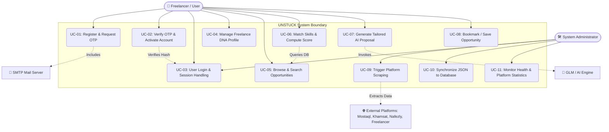

# 1.2 Use Case Diagram & Descriptions
## UNSTUCK – Intelligent Freelance Intelligence Platform

---

## 1. System Actors

| Actor | Type | Description |
| :--- | :--- | :--- |
| **Freelancer / Job Seeker** | Primary Human Actor | Registers, configures Freelance DNA profile, browses matched opportunities, bookmarks projects, and generates customized AI proposals. |
| **System Administrator** | Secondary Human Actor | Monitors scraper health, triggers manual crawls, inspects database connection, and syncs JSON cache with PostgreSQL. |
| **External Freelance Platforms** | External Secondary Actor | Mostaql, Khamsat, Nafezly, and Freelancer.com from which project listings are extracted. |
| **SMTP Mail Server** | External Secondary System | Dispatches 6-digit OTP verification emails to registering users via TLS. |
| **AI LLM Engine (GLM-4 / Local)** | External Secondary System | Analyzes job brief and user achievements to produce context-aware proposals. |
| **n8n Orchestration Engine** | Automated System Actor | Executes scheduled cron jobs to trigger automated multi-spider crawls. |

---

## 2. Use Case Diagram (UML)

---

## 3. Detailed Use Case Specifications

### UC-01: Register & Request Email OTP
- **Actor:** Freelancer
- **Preconditions:** User is not registered or account is unverified.
- **Trigger:** User fills in Full Name, Email, and Password on SignUp Page and clicks "Create Account".
- **Basic Flow:**
  1. Frontend sends `POST /api/auth/register` with `full_name`, `email`, and `password`.
  2. Backend validates password complexity (min 10 chars, uppercase, lowercase, digit, special symbol).
  3. Backend generates salted bcrypt password hash.
  4. Backend creates a secure 6-digit OTP, computes its SHA-256 hash, and stores record in `otp_verifications` with 5-minute expiry.
  5. Backend connects via TLS to SMTP Mail Server and dispatches OTP email.
  6. Frontend redirects user to OTP Verification Page.
- **Alternative Flow:**
  - 3a. Email already registered: Return HTTP 400 "Email already in use".
  - 5a. SMTP delivery error: System logs error and maintains pending state.
- **Postconditions:** User record created with `is_verified = False`; OTP sent to email.

---

### UC-02: Verify OTP & Activate Account
- **Actor:** Freelancer
- **Preconditions:** Pending user record exists in database with valid OTP record.
- **Trigger:** User enters 6-digit OTP code on Verify OTP Page.
- **Basic Flow:**
  1. Frontend sends `POST /api/auth/verify-otp` with `email` and `otp`.
  2. Backend validates that `attempts < 5` and `expires_at > NOW()`.
  3. Backend computes SHA-256 hash of submitted OTP and compares with stored hash.
  4. If match, backend marks `is_used = True`, sets user `is_verified = True`, and updates `verified_at`.
  5. Returns success payload and allows user to proceed to Onboarding / DNA setup.
- **Alternative Flow:**
  - 2a. OTP expired: Return error "OTP expired. Please request a new code."
  - 3a. Invalid OTP: Increment `attempts`. If `attempts >= 5`, invalidate OTP and block verification.
- **Postconditions:** User is active and verified.

---

### UC-03: Manage Freelance DNA™ Profile
- **Actor:** Freelancer
- **Preconditions:** User is authenticated.
- **Trigger:** User navigates to Settings or Freelance DNA page.
- **Basic Flow:**
  1. User selects skills (e.g., React, Python, FastAPI, UI Design, Data Engineering).
  2. User specifies hourly rate range, preferred platforms, language preference, and bio.
  3. Profile is saved in client local storage and synced with backend session.
- **Postconditions:** Matching engine uses updated DNA parameters for real-time scoring.

---

### UC-04: Browse & Search Opportunities
- **Actor:** Freelancer
- **Preconditions:** System has scraped projects available.
- **Trigger:** User navigates to Opportunities Page.
- **Basic Flow:**
  1. Frontend calls `GET /api/projects?platform=all&q=keyword&limit=50&offset=0`.
  2. Backend queries PostgreSQL table `projects` with index-backed search.
  3. If database is unreachable, backend falls back automatically to cached JSON files in `output/`.
  4. User views projects with title, platform badge, price, duration, published time, and required skills.
- **Postconditions:** Filtered list of projects is displayed to user.

---

### UC-05: Match Skills & Compute Fit Score
- **Actor:** Freelancer
- **Preconditions:** User has skills entered in Freelance DNA.
- **Trigger:** User opens "Your Signal Today" or clicks "Match My DNA".
- **Basic Flow:**
  1. Frontend sends `POST /api/match` with array of `user_skills`.
  2. Backend queries latest projects from PostgreSQL or JSON fallback.
  3. Algorithm computes ratio of matching skills, checks title & brief for contextual keywords.
  4. Calculates match percentage (0–100%) and categorizes skills into `matched_skills` and `missing_skills`.
  5. Generates human-readable explanation reasons (e.g., "95% Match: Excellent alignment with React, Python, and FastAPI").
  6. Returns sorted list ordered by highest match score.
- **Postconditions:** Freelancer sees highest-probability jobs at the top of their dashboard.

---

### UC-06: Generate Tailored AI Proposal
- **Actor:** Freelancer
- **Preconditions:** Target project selected.
- **Trigger:** User clicks "Generate Proposal" on Opportunity Detail page.
- **Basic Flow:**
  1. Frontend sends `POST /api/generate-proposal` with project title, brief, skills, user profile, selected tone (`value` or `direct`), and language (`arabic` or `english`).
  2. Backend invokes `GLM-4 Flash` LLM via Bearer authentication or executes internal Smart Generator engine if offline.
  3. AI crafts a tailored, persuasive proposal addressing client pain points directly.
  4. Proposal returned to frontend with copy-to-clipboard and edit options.
- **Postconditions:** Freelancer possesses a ready-to-submit customized proposal.

---

### UC-07: Trigger Platform Scraping & Synchronization
- **Actor:** System Administrator / n8n Automation Engine
- **Preconditions:** Network access to target freelance platforms.
- **Trigger:** Admin clicks "Scrape Now" in Admin Scraper Hub or n8n executes scheduled cron.
- **Basic Flow:**
  1. Call `POST /api/scrape` with `platforms: ["all"]`.
  2. FastAPI launches Scrapy runner via background subprocess (`run.py`).
  3. Spiders crawl Mostaql, Khamsat, Nafezly, and Freelancer.
  4. Pipelines execute PostgreSQL `UPSERT` on `projects` table using `ON CONFLICT (url) DO UPDATE`.
  5. Output JSON backup files updated in `output/` folder.
- **Postconditions:** Database populated with latest real-time listings; duplicate records prevented.
