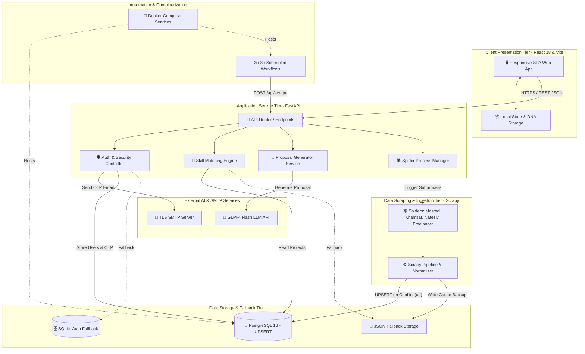

# 1.4 Software Architecture
## UNSTUCK – Intelligent Freelance Intelligence Platform

---

## 1. Architectural Style & Overview

UNSTUCK adopts a **Decoupled Multi-Tier Modular Architecture** combining:
1. A **Single Page Application (SPA)** presentation tier built with React 18 and Vite.
2. An **Asynchronous RESTful API Gateway & Service Layer** powered by FastAPI.
3. An **Autonomous Scraping & Ingestion Engine** powered by Scrapy and background threads.
4. An **External AI Intelligence Integration** leveraging GLM-4 Flash Large Language Models.
5. A **High-Integrity Persistence Tier** featuring PostgreSQL with native `UPSERT`, accompanied by SQLite and JSON fallback mechanisms.
6. A **Workflow Automation Tier** utilizing n8n and Docker Compose for scheduled polling and tasks.

---

## 2. High-Level Architecture Diagram

---

## 3. Detailed Architectural Layers

### 3.1 Presentation Layer (Frontend SPA)
- **Technology:** React 18, Vite 5, Vanilla CSS Design System with Pantone Palette, Lucide React icons.
- **Key Responsibilities:**
  - Fast client-side routing and reactive view transitions without page reloads.
  - State management for session auth, Freelance DNA attributes, and user notifications.
  - Dynamic proposal generation editor with one-click copy and tone switching.
  - Zero-build browser portability via standalone HTML compilation (`OPEN_WEBSITE.html`).

### 3.2 Application & Business Logic Layer (FastAPI Backend)
- **Technology:** Python 3.11+, FastAPI, Starlette, Pydantic, Uvicorn ASGI Server.
- **Key Responsibilities:**
  - Data validation and serialization via Pydantic schema models (`RegisterRequest`, `VerifyOtpRequest`, `MatchRequest`, `ProposalRequest`).
  - Secure bcrypt salting and hashing for passwords.
  - Cryptographic OTP generation, SHA-256 storage, and SMTP TLS transmission.
  - Non-blocking asynchronous endpoints handling concurrent client requests.

### 3.3 Data Ingestion & Crawling Layer (Scrapy Engine)
- **Technology:** Scrapy Framework, Python Requests, Twisted Event Loop.
- **Key Responsibilities:**
  - Targeted spiders for Mostaql, Khamsat, Nafezly, and Freelancer.com.
  - XPath and CSS selector extraction for titles, budgets, durations, deadlines, and skill requirements.
  - Time localization (converting relative Arabic strings such as "منذ نصف ساعة" into ISO timestamps).
  - Pipelines performing real-time PostgreSQL database upserts.

### 3.4 Persistence & Storage Layer
- **Technology:** PostgreSQL 16 Alpine, Psycopg2, SQLite3, JSON.
- **Key Responsibilities:**
  - Primary relational storage with indexed tables (`projects`, `users`, `otp_verifications`).
  - Atomic database transactions with automated commit and rollback management.
  - Self-healing resilience: If PostgreSQL is unreachable during read queries, the backend automatically serves records from verified JSON cache files in `output/`.

### 3.5 External Integrations & Orchestration Layer
- **Technology:** GLM-4 Flash API, TLS SMTP (Port 587), n8n Automation Engine, Docker Compose.
- **Key Responsibilities:**
  - Autonomous periodic triggers (hourly schedule) pulling fresh projects across platforms.
  - Natural Language Processing (NLP) inference crafting contextual Arabic and English proposals.
