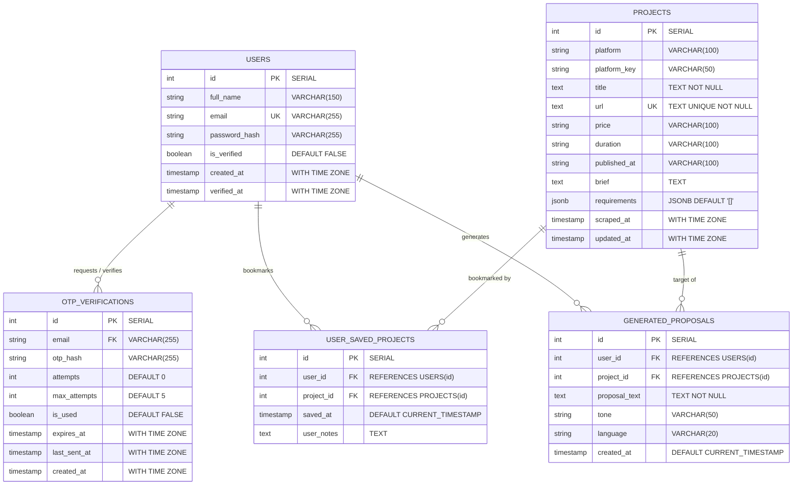

# 2.1 Entity-Relationship Diagram (ERD)
## UNSTUCK – Intelligent Freelance Intelligence Platform

---

## 1. Conceptual & Logical ER Model Overview

The database design for UNSTUCK is modeled to support high-throughput project ingestion, real-time deduplication via unique constraints, secure multi-step email OTP authentication, and user-centric profile customization.

### Core Entities:
1. **USERS:** Stores verified and pending user accounts, hashed credentials, and verification timestamps.
2. **OTP_VERIFICATIONS:** Manages short-lived cryptographic one-time passwords for email validation, tracking attempt counters and expiration windows.
3. **PROJECTS:** The central operational repository storing scraped opportunities across Mostaql, Khamsat, Nafezly, and Freelancer.com with a unique URL constraint powering `UPSERT` operations.
4. **USER_SAVED_PROJECTS (Bookmarks):** Resolves the Many-to-Many ($M:N$) relationship between users and the projects they bookmark for follow-up.
5. **GENERATED_PROPOSALS:** Records AI-generated proposals crafted for specific projects by authenticated users, preserving the applied tone and language.

---

## 2. Entity-Relationship Diagram (Mermaid)

---

## 3. Cardinality & Relationship Breakdown

| Entity Relationship | Cardinality | Business Rule & Description |
| :--- | :--- | :--- |
| **USERS to OTP_VERIFICATIONS** | **1 : N** | A single user (by email) can request multiple OTP verification codes over time (e.g., initial registration, resend code), but each OTP record corresponds to one user email. |
| **USERS to USER_SAVED_PROJECTS** | **1 : N** | A user may bookmark multiple projects to track them later. |
| **PROJECTS to USER_SAVED_PROJECTS** | **1 : N** | A single project opportunity can be saved/bookmarked by multiple freelancers. |
| **USERS to GENERATED_PROPOSALS** | **1 : N** | A user can generate numerous customized proposals with differing tones (Value vs. Direct) across various opportunities. |
| **PROJECTS to GENERATED_PROPOSALS** | **1 : N** | A project can serve as the target for multiple proposal drafts. |
