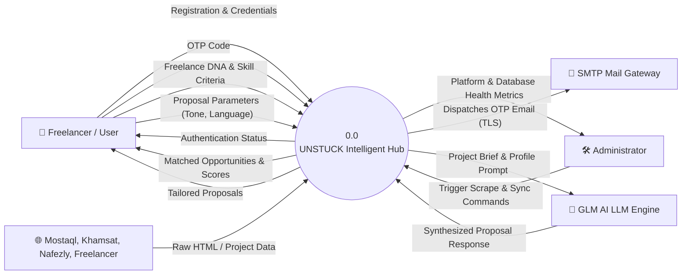
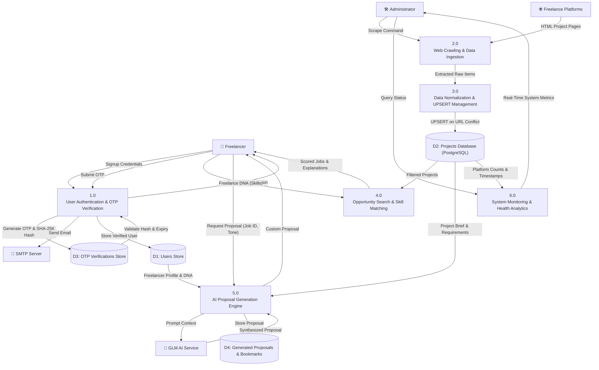

# 3.1 Data Flow Diagrams (DFD)
## UNSTUCK – Intelligent Freelance Intelligence Platform

---

## 1. DFD Level 0 (Context Diagram)

The Context Diagram defines the system boundary for UNSTUCK, illustrating external entities and the primary input/output data flows traversing the perimeter.

---

## 2. DFD Level 1 (Decomposition Diagram)

DFD Level 1 decomposes the system into primary functional processes, data stores, and internal data pipelines.

---

## 3. Data Flow Dictionary

| Flow Name | Source | Destination | Data Structure Elements |
| :--- | :--- | :--- | :--- |
| **Signup Credentials** | User | Process 1.0 | `full_name`, `email`, `password` |
| **OTP Transmission** | Process 1.0 | SMTP Server | `email`, `subject`, `html_body` (containing 6-digit code) |
| **Raw Project Data** | Platforms | Process 2.0 | HTML elements, URLs, relative dates, budget tags |
| **Normalized Item** | Process 2.0 | Process 3.0 | `platform_key`, `title`, `url`, `price`, `duration`, `published_at`, `brief`, `requirements` |
| **UPSERT Transaction** | Process 3.0 | D2 (Projects) | SQL `INSERT ... ON CONFLICT (url) DO UPDATE SET updated_at = NOW()` |
| **DNA Query** | User | Process 4.0 | `user_skills: ["React", "Python", "FastAPI"]`, `limit: 50` |
| **Match Results** | Process 4.0 | User | `match_score`, `matched_skills`, `missing_skills`, `reasons` |
| **Proposal Request**| User | Process 5.0 | `project_title`, `project_brief`, `tone`, `language`, `user_profile` |
| **Final Proposal** | Process 5.0 | User | Formatted proposal text ready for clipboard copy |
