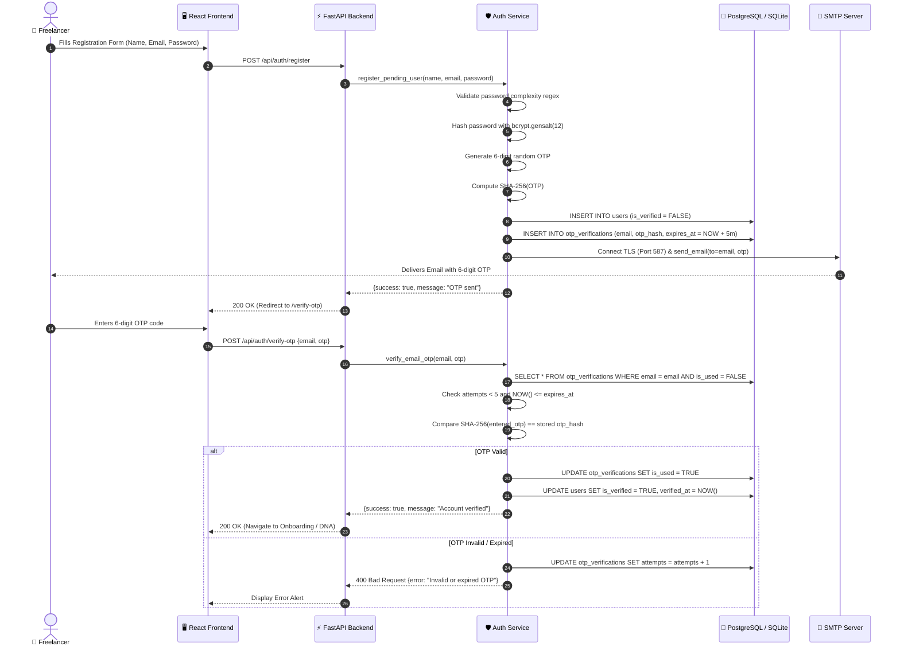
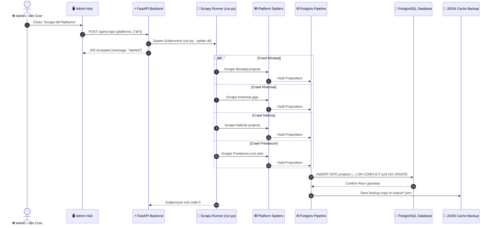
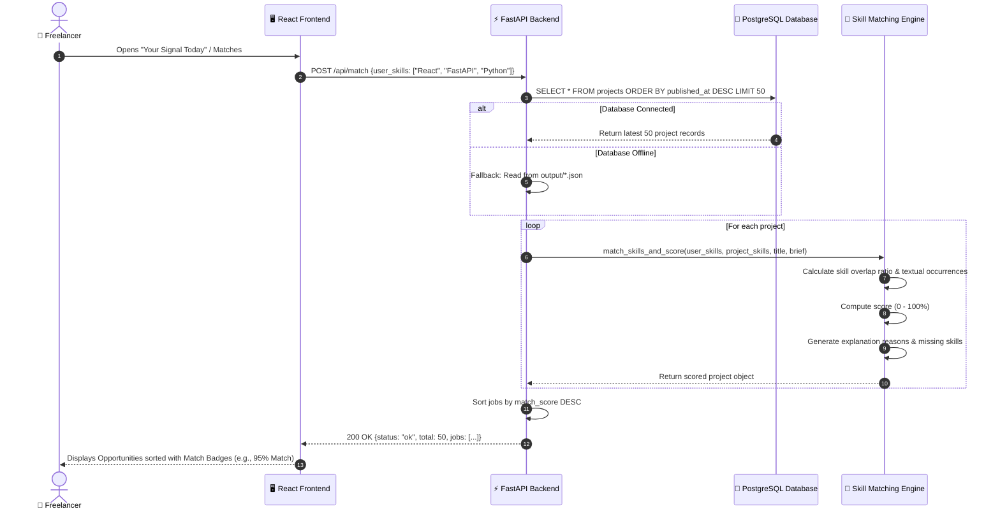
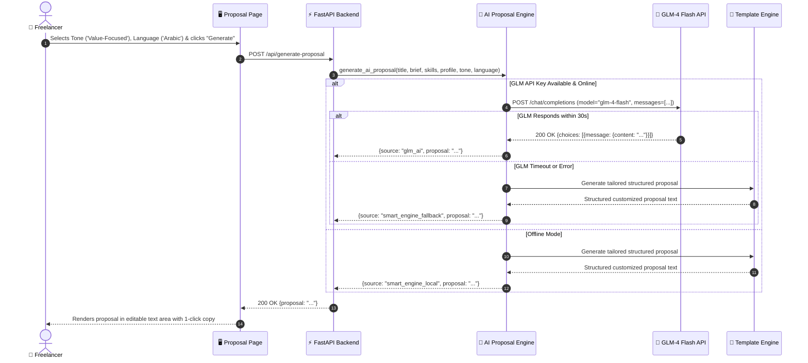

# 3.2 Sequence Diagrams
## UNSTUCK – Intelligent Freelance Intelligence Platform

---

## 1. Sequence 1: User Registration, OTP Email Dispatch & Account Verification

This sequence models the secure onboarding flow, emphasizing the cryptographic hashing of OTP tokens and SMTP transmission.

---

## 2. Sequence 2: Autonomous Scraping & PostgreSQL UPSERT Ingestion

This sequence models the execution of crawlers across platforms and real-time database synchronization.

---

## 3. Sequence 3: AI Skill Matching & Opportunities Scoring

---

## 4. Sequence 4: AI Proposal Generation with Intelligent Fallback

