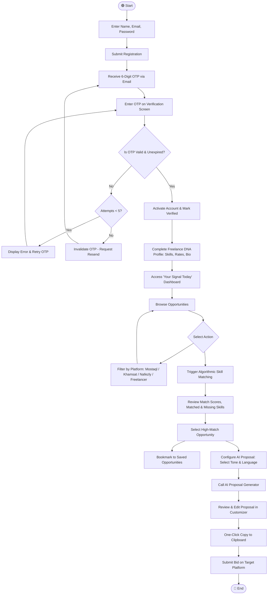
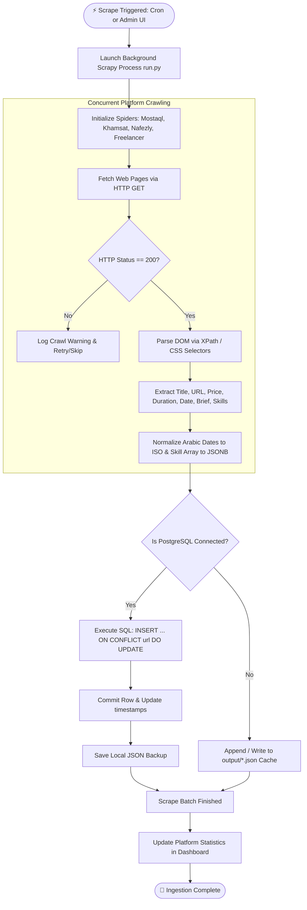

# 3.3 Activity Diagrams
## UNSTUCK – Intelligent Freelance Intelligence Platform

---

## 1. Activity Diagram 1: Freelancer Operational Workflow

This activity diagram tracks the end-to-end journey of a freelancer utilizing the UNSTUCK platform from initial account creation to customized proposal delivery.

---

## 2. Activity Diagram 2: Autonomous Scraping & Data Ingestion Pipeline

This activity diagram captures the technical pipeline executed by the Scrapy crawler and database engine.

