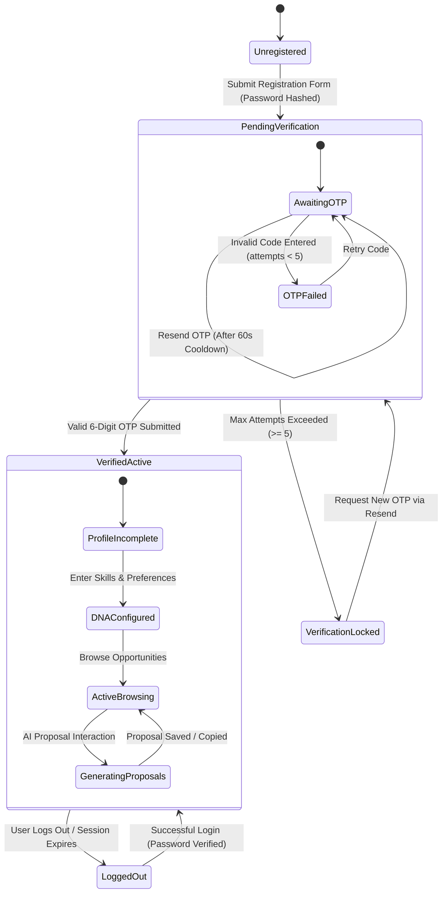
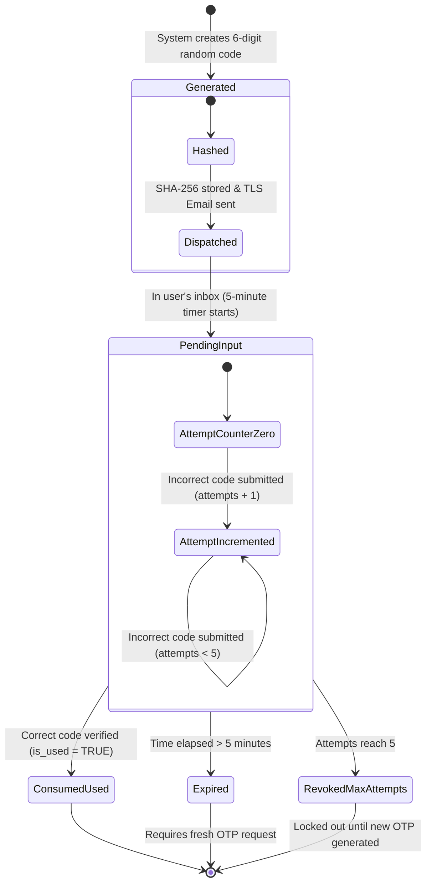
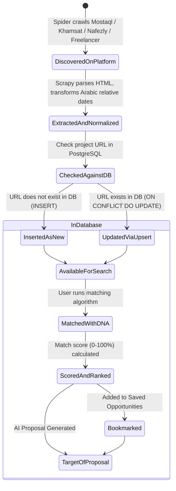

# 3.4 State Machine Diagrams
## UNSTUCK – Intelligent Freelance Intelligence Platform

---

## 1. State Diagram 1: User Account Lifecycle

This state machine models the lifecycle of a user account from initial registration through email OTP verification to active operation.

---

## 2. State Diagram 2: OTP Verification Token Lifecycle

---

## 3. State Diagram 3: Project Opportunity Record Lifecycle

