# 3.5 Class Diagram (Object-Oriented Design)
## UNSTUCK – Intelligent Freelance Intelligence Platform

---

## 1. Class Diagram Overview

The class diagram visualizes the object-oriented structure of the UNSTUCK platform, demonstrating domain models, service managers, crawler hierarchies, and external interface controllers.

```mermaid
classDiagram
    %% Core Domain Models
    class User {
        +int id
        +string full_name
        +string email
        +string password_hash
        +bool is_verified
        +datetime created_at
        +datetime verified_at
        +verify_password(plain_password) bool
        +mark_verified() void
    }

    class OTPVerification {
        +int id
        +string email
        +string otp_hash
        +int attempts
        +int max_attempts
        +bool is_used
        +datetime expires_at
        +datetime last_sent_at
        +is_expired() bool
        +increment_attempts() int
        +verify_code(plain_otp) bool
    }

    class Project {
        +int id
        +string platform
        +string platform_key
        +string title
        +string url
        +string price
        +string duration
        +string published_at
        +string brief
        +list requirements
        +datetime scraped_at
        +datetime updated_at
        +to_dict() dict
    }

    class FreelanceDNAProfile {
        +string full_name
        +string professional_title
        +list skills
        +string hourly_rate
        +list preferred_platforms
        +string bio
        +to_prompt_context() string
    }

    %% Service Managers
    class DatabaseManager {
        -dict db_config
        +get_connection() Connection
        +get_db_cursor(commit) Cursor
        +init_db() void
        +get_db_health() dict
        +query_projects(platforms, q, limit, offset) tuple
        +upsert_project(conn, item, platform_key) bool
        +sync_json_files_to_db() dict
    }

    class AuthService {
        -string sqlite_db_path
        -string smtp_host
        -int smtp_port
        +init_auth_tables() void
        +register_pending_user(name, email, password) dict
        +verify_email_otp(email, otp) dict
        +resend_otp(email) dict
        +authenticate_user(email, password) dict
        -send_otp_email(to_email, otp) bool
        -hash_otp(otp) string
    }

    class SkillMatchingEngine {
        +match_skills_and_score(user_skills, project_skills, title, brief) dict
        -calculate_overlap(user_skills, project_skills) float
        -scan_text_for_keywords(text, skills) list
    }

    class AIProposalEngine {
        -string api_key
        -string base_url
        -string model_name
        +generate_ai_proposal(title, brief, skills, user_profile, tone, language) dict
        -call_glm_chat(messages, temperature) string
        -generate_fallback_template(title, brief, profile, tone, language) string
    }

    %% Crawler Hierarchy
    class BaseSpider {
        <<abstract>>
        +string name
        +list start_urls
        +parse(response)* void
        #extract_common_fields(item) dict
    }

    class MostaqlSpider {
        +name: "mostaql"
        +parse(response) void
        -parse_project_detail(response) void
    }

    class KhamsatSpider {
        +name: "khamsat"
        +parse(response) void
    }

    class NafezlySpider {
        +name: "nafezly"
        +parse(response) void
    }

    class FreelancerSpider {
        +name: "freelancer"
        +parse(response) void
    }

    %% Relationships
    BaseSpider <|-- MostaqlSpider
    BaseSpider <|-- KhamsatSpider
    BaseSpider <|-- NafezlySpider
    BaseSpider <|-- FreelancerSpider

    User "1" o-- "0..*" OTPVerification : requests
    User "1" o-- "1" FreelanceDNAProfile : possesses
    
    AuthService ..> User : manages
    AuthService ..> OTPVerification : validates
    DatabaseManager ..> Project : stores & retrieves

    SkillMatchingEngine ..> Project : evaluates
    SkillMatchingEngine ..> FreelanceDNAProfile : compares

    AIProposalEngine ..> Project : analyzes
    AIProposalEngine ..> FreelanceDNAProfile : incorporates
```

---

## 2. Key Class Responsibilities & Method Signatures

### 2.1 `DatabaseManager`
- `query_projects(platforms: list, q: str, limit: int, offset: int) -> Tuple[int, List[dict]]`: Executes index-optimized SQL filtering over `projects`, returning total match count and paginated project list.
- `upsert_project(conn, item: dict, platform_key: str) -> bool`: Executes PostgreSQL atomic `INSERT ... ON CONFLICT (url) DO UPDATE`.

### 2.2 `AuthService`
- `register_pending_user(full_name: str, email: str, password: str) -> dict`: Enforces password complexity, hashes password with `bcrypt`, generates 6-digit OTP, stores SHA-256 digest, and sends verification email via SMTP.
- `verify_email_otp(email: str, otp: str) -> dict`: Compares SHA-256 digest of input code against stored token, verifies timestamp `expires_at > NOW()`, checks `attempts < 5`, and toggles `is_verified = TRUE`.

### 2.3 `SkillMatchingEngine`
- `match_skills_and_score(user_skills: list, project_skills: list, title: str, brief: str) -> dict`: Calculates match ratio, scans project title and brief for latent keyword occurrences, clamps score between 35% and 98%, and generates human-readable justification reasons.

### 2.4 `AIProposalEngine`
- `generate_ai_proposal(title: str, brief: str, skills: list, user_profile: dict, tone: str, language: str) -> dict`: Assembles customized prompt combining user achievements and project pain points, invokes GLM-4 Flash API, and seamlessly delegates to rule-based template generation if offline.
