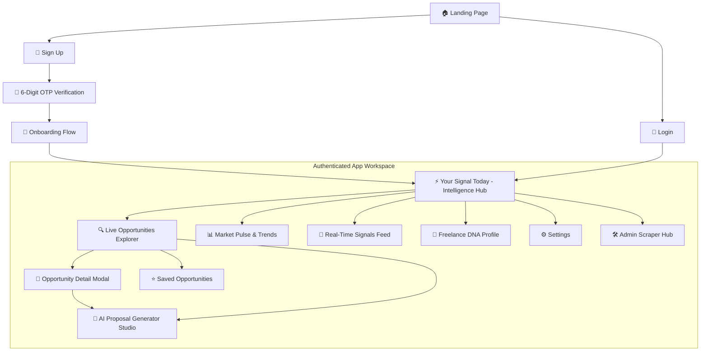

# 4.1 Wireframes & Screen Mockups
## UNSTUCK – Intelligent Freelance Intelligence Platform

---

## 1. Interface Navigation Structure (Information Architecture)



---

## 2. Key Screen Wireframes & UI Specifications

### 2.1 Screen 1: Landing Page (`LandingPage.jsx`)
- **Purpose:** Public showcase explaining the platform value proposition, live platform counters, and quick CTA buttons.
- **Wireframe Layout:**
```text
+-----------------------------------------------------------------------------------+
|  [UNSTUCK LOGO]                      Features   How It Works   Admin   [LOGIN] [SIGN UP] |
+-----------------------------------------------------------------------------------+
|                                                                                   |
|           Stop Searching. Start Winning Freelance Gigs in Real-Time.              |
|   Aggregating Mostaql, Khamsat, Nafezly & Freelancer with AI-Powered Proposals   |
|                                                                                   |
|                    [  🚀 Get Started Free  ]    [ 📖 Explore Demo ]               |
|                                                                                   |
|  +--------------------+ +--------------------+ +--------------------+ +---------+ |
|  | 🟢 Mostaql         | | 🟠 Khamsat         | | 🔵 Nafezly         | | 🔷 Freel| |
|  | 142 Active Gigs    | | 89 Micro Tasks     | | 64 Projects        | | 310 Gigs| |
|  +--------------------+ +--------------------+ +--------------------+ +---------+ |
|                                                                                   |
|  [ Feature: PostgreSQL UPSERT ]  [ Feature: 6-Digit OTP ]  [ Feature: GLM AI ]    |
+-----------------------------------------------------------------------------------+
```

---

### 2.2 Screen 2: 6-Digit Email OTP Verification (`VerifyOtpPage.jsx`)
- **Purpose:** Secure activation gate requiring the user to submit the cryptographic OTP sent to their inbox.
- **Wireframe Layout:**
```text
+-----------------------------------------------------------------------------------+
|                                 [UNSTUCK LOGO]                                    |
+-----------------------------------------------------------------------------------+
|                                                                                   |
|                              🔐 Verify Your Email                                 |
|         We sent a 6-digit confirmation code to: user@example.com                  |
|                                                                                   |
|                     +-----+ +-----+ +-----+ +-----+ +-----+ +-----+               |
|                     |  4  | |  8  | |  2  | |  9  | |  1  | |  5  |               |
|                     +-----+ +-----+ +-----+ +-----+ +-----+ +-----+               |
|                                                                                   |
|                        ⏳ Code expires in: 04:32                                  |
|                        🔒 Security: Attempts remaining: 5/5                       |
|                                                                                   |
|                           [  ✅ Verify Account  ]                                 |
|                                                                                   |
|                 Didn't receive the code? [ Resend Code (48s) ]                    |
|                                                                                   |
+-----------------------------------------------------------------------------------+
```

---

### 2.3 Screen 3: "Your Signal Today" Dashboard (`YourSignalToday.jsx`)
- **Purpose:** Main hub for authenticated freelancers showing top AI-scored matches, daily metrics, and high-priority alerts.
- **Wireframe Layout:**
```text
+-----------------------------------------------------------------------------------+
| [UNSTUCK]  Signal Today   Opportunities   Saved(4)   Market Pulse   DNA  [User ▼] |
+-----------------------------------------------------------------------------------+
|  👋 Welcome back, Ahmed! | Freelance DNA: Full-Stack React & Python | Match Tier: High|
|                                                                                   |
|  +-------------------+  +-------------------+  +-------------------+  +---------+ |
|  | 🎯 Top Match Score|  | ⚡ Fresh Gigs 24h |  | 📝 Proposals Sent |  | ⏱️ Avg..| |
|  |      96% Fit      |  |     48 New Jobs   |  |     12 Generated  |  | < 2 min | |
|  +-------------------+  +-------------------+  +-------------------+  +---------+ |
|                                                                                   |
|  🔥 HIGHEST PROBABILITY OPPORTUNITIES TODAY                                       |
|  +------------------------------------------------------------------------------+ |
|  | [🟢 Mostaql] Build Intelligent Dashboard in React & FastAPI  | 🌟 96% MATCH   | |
|  | Budget: $150 - $300 | Duration: 5 days | Published: 22m ago                  | |
|  | Skills: [React] [FastAPI] [PostgreSQL] [Tailwind]                           | |
|  | Why: Matches 4/4 core skills from your Freelance DNA profile                 | |
|  |             [ 📄 View Details ]    [ 🤖 Generate Proposal ]                  | |
|  +------------------------------------------------------------------------------+ |
+-----------------------------------------------------------------------------------+
```

---

### 2.4 Screen 4: Opportunities Explorer (`OpportunitiesPage.jsx`)
- **Purpose:** Search and filter engine over all scraped jobs across all 4 platforms.
- **Wireframe Layout:**
```text
+-----------------------------------------------------------------------------------+
|  Search: [ Enter keywords (e.g., Python, React, Scraper)...        ] [🔍 Search]  |
|  Platforms: [x] All   [ ] Mostaql   [ ] Khamsat   [ ] Nafezly   [ ] Freelancer    |
|  Sort by: [ Newest First ▼ ]   Min Match: [ 70%+ ▼ ]                              |
+-----------------------------------------------------------------------------------+
|  Showing 148 Live Opportunities (Synced with PostgreSQL)                          |
|                                                                                   |
|  +------------------------------------------------------------------------------+ |
|  | [🔵 Nafezly] Web Scraper Developer for E-Commerce Data      | 🌟 91% MATCH   | |
|  | $80.00 | 3 Days | Published: 40m ago                                         | |
|  | Requirements: [Python] [Scrapy] [Data Ingestion]                             | |
|  | [⭐ Save] [ 📄 Details ] [ 🤖 Quick Proposal ]                                | |
|  +------------------------------------------------------------------------------+ |
|  | [🟠 Khamsat] API Technical Documentation & System Guide       | 🌟 84% MATCH   | |
|  | $25.00 | 1 Day | Published: 1h ago                                           | |
|  | [⭐ Save] [ 📄 Details ] [ 🤖 Quick Proposal ]                                | |
|  +------------------------------------------------------------------------------+ |
|                                  [ < Previous ] Page 1 of 8 [ Next > ]            |
+-----------------------------------------------------------------------------------+
```

---

### 2.5 Screen 5: AI Proposal Studio (`ProposalGeneratorPage.jsx`)
- **Purpose:** Interactive proposal studio powered by GLM-4 Flash / Intelligent Engine.
- **Wireframe Layout:**
```text
+-----------------------------------------------------------------------------------+
| 🤖 AI PROPOSAL STUDIO                                      [ ← Back to Project ]  |
| Target: "Build Intelligent Dashboard in React & FastAPI" (Mostaql - $250.00)      |
+---------------------------------------------------------+-------------------------+
| Configure Proposal Tone & Style                         | AI Output & Editor      |
|                                                         |                         |
| Tone:                                                   | [ English ] [ Arabic ]  |
| (•) Value-Focused (Emphasizes ROI, speed & quality)     | +---------------------+ |
| ( ) Direct & Fast (Concise execution roadmap)           | | Hello,                | |
|                                                         | | I reviewed your...  | |
| Key Freelancer Highlights Included:                     | | Having engineered...| |
| [x] 4+ Years Experience in React & FastAPI              | | production dashboards| |
| [x] Experience with PostgreSQL Upsert & Real-Time Sync  | | I can deliver...    | |
|                                                         | +---------------------+ |
| [ ⚡ Generate Winning Proposal with GLM AI ]            | [📋 Copy to Clipboard]|
|                                                         | [ ⭐ Save Draft ]       |
+---------------------------------------------------------+-------------------------+
```

---

### 2.6 Screen 6: Admin Scraper Hub (`AdminScraperHub.jsx`)
- **Purpose:** Admin command center for database health monitoring, crawler execution, and JSON-PostgreSQL syncing.
- **Wireframe Layout:**
```text
+-----------------------------------------------------------------------------------+
| 🛠️ ADMIN SCRAPER & INFRASTRUCTURE HUB                                             |
+-----------------------------------------------------------------------------------+
| Database Health: 🟢 CONNECTED (PostgreSQL 16) | Total Stored Projects: 842         |
|                                                                                   |
| Platform Status & Last Crawl:                                                     |
| • Mostaql:       242 projects | Last crawled: 2026-11-06 23:45:10                 |
| • Khamsat:       185 projects | Last crawled: 2026-11-06 23:45:15                 |
| • Nafezly:       112 projects | Last crawled: 2026-11-06 23:45:20                 |
| • Freelancer:    303 projects | Last crawled: 2026-11-06 23:45:25                 |
|                                                                                   |
| Actions:                                                                          |
| [ 🕷️ Run All Spiders (Scrapy) ]  [ 🔄 Sync JSON Files to PostgreSQL DB ]           |
| [ 🧹 Clean Inactive Cache ]       [ 📥 Export DB Dump ]                           |
+-----------------------------------------------------------------------------------+
```
