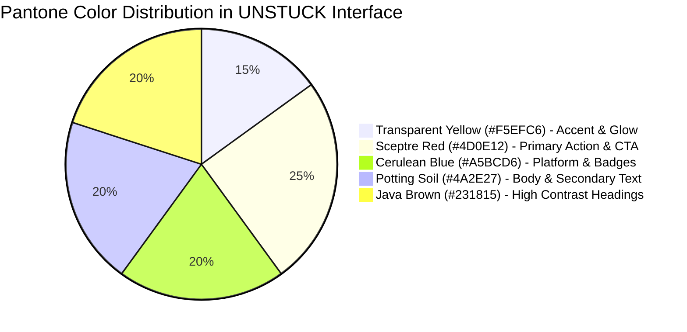

# 4.2 UI/UX Guidelines & Design System Specification
## UNSTUCK – Intelligent Freelance Intelligence Platform

---

## 1. Design Philosophy & Aesthetic Identity

UNSTUCK merges the clarity of an **Editorial Publication** with the speed of an **Advanced Financial Terminal**. The visual identity rejects sterile generic dashboard templates in favor of a curated, bespoke palette rooted in official Pantone color harmonies.

### Core Principles:
1. **Content-First Hierarchy:** Opportunities, match scores, and action items dominate the visual hierarchy.
2. **Instant Cognitive Clarity:** Key data (budget, timeline, platform origin, match percentage) are immediately scannable within 500 milliseconds.
3. **Harmonious Tactility:** Elevated card surfaces, subtle borders, and intentional warm backgrounds reduce eye fatigue during extended browsing sessions.
4. **Bilingual Elegance:** Native typographic balance honoring both Right-to-Left (Arabic) and Left-to-Right (English) layouts.

---

## 2. Color Palette & Semantic Tokens

The design system is anchored in an authoritative **Pantone Color Palette** defined in `src/design-system.css`:

### 2.1 Palette Specifications Table

| Color Role | Pantone Name | Hex Code | RGB | Interface Application |
| :--- | :--- | :--- | :--- | :--- |
| **Primary Accent** | Transparent Yellow | `#F5EFC6` | `245, 239, 198` | Highlights, active badges, ambient glow, card headers |
| **Primary Action** | Sceptre Red | `#4D0E12` | `77, 14, 18` | Primary CTA buttons, key action links, focus borders |
| **Action Hover** | Sceptre Dark | `#38090C` | `56, 9, 12` | Hover and active pressed states for primary buttons |
| **Interactive Secondary** | Cerulean Blue | `#A5BCD6` | `165, 188, 214` | Secondary tags, platform identifiers, subtle outlines |
| **Deep Ceramic** | Deep Blue Cerulean | `#2A4C73` | `42, 76, 115` | Informational callouts and technical stats |
| **Neutral Warm Body** | Potting Soil | `#4A2E27` | `74, 46, 39` | Primary descriptive body copy, secondary headers |
| **Neutral High Contrast**| Java Brown | `#231815` | `35, 24, 21` | Main titles, h1/h2 headings, high-contrast borders |
| **Page Canvas Background**| Warm Cream | `#FAF8F5` | `250, 248, 245` | Global body background preventing stark white glare |
| **Surface Elevated** | Pure White | `#FFFFFF` | `255, 255, 255` | Elevated project cards, modal dialogs, drawer panels |

---

## 3. Typography System

The typographic scale uses modern variable font families engineered for cross-lingual legibility (`Inter` for Latin scripts and `Cairo` / `IBM Plex Sans Arabic` for Arabic content).

| Level | Size | Weight | Line Height | Letter Spacing | Purpose |
| :--- | :--- | :--- | :--- | :--- | :--- |
| **Display Title (H1)** | 32px (2.0rem) | 800 (Extrabold) | 1.2 | -0.025em | Main dashboard & landing page hero |
| **Section Header (H2)**| 24px (1.5rem) | 700 (Bold) | 1.3 | -0.015em | Module headers and modal titles |
| **Card Header (H3)** | 18px (1.125rem)| 600 (Semibold) | 1.4 | -0.01em | Project listing titles & feature titles |
| **Body Large** | 16px (1.0rem) | 400 (Regular) | 1.6 | normal | Project descriptions & briefs |
| **Body Standard** | 14px (0.875rem)| 400 / 500 | 1.5 | normal | Metadata, secondary descriptions |
| **Caption / Badge** | 12px (0.75rem) | 600 (Semibold) | 1.3 | +0.02em | Match percentage badges, platform labels |

---

## 4. Spacing, Elevation & Component Radii

### 4.1 Spatial Rhythm (8pt Grid System)
- `--space-1`: `4px`
- `--space-2`: `8px`
- `--space-3`: `12px`
- `--space-4`: `16px`
- `--space-6`: `24px`
- `--space-8`: `32px`

### 4.2 Elevation Shadows
- **Card Flat / Bordered:** `0 2px 8px rgba(35, 24, 21, 0.04)` with `1px solid #E7E0D6`
- **Elevated Hover:** `0 8px 24px rgba(35, 24, 21, 0.07)`
- **Modal Dialog & Popover:** `0 16px 40px rgba(35, 24, 21, 0.12)`

### 4.3 Corner Radii
- **Badges & Pills:** `9999px` (Full Pill)
- **Buttons & Input Fields:** `8px` (`--radius-sm`)
- **Cards & Modals:** `14px` (`--radius-md`)

---

## 5. Accessibility & Inclusivity Guidelines (WCAG 2.1 AA)

1. **Contrast Compliance:**
   All text elements against their respective backgrounds strictly maintain a minimum contrast ratio of **4.5:1** for standard body text and **3.0:1** for large headers.
   - Text `#231815` on `#FAF8F5` achieves an exceptional contrast ratio of **14.8:1**.
   - CTA Text `#FFFFFF` on `#4D0E12` achieves **9.2:1**.

2. **Accessible Form States:**
   Input fields provide unmistakable `:focus-visible` styling utilizing a `2px solid #4D0E12` ring and a `2px` offset.

3. **Motion Sensitivity:**
   All micro-interactions and transitions respect the user's operating system preferences via `@media (prefers-reduced-motion: reduce)`.

4. **Screen Reader Optimization:**
   Icons from Lucide React are accompanied by explicit `aria-label` or `aria-hidden="true"` attributes to prevent verbal clutter for screen reader users.
