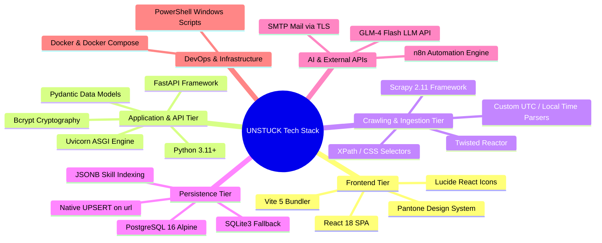

# 5.1 Technology Stack Specification
## UNSTUCK – Intelligent Freelance Intelligence Platform

---

## 1. Comprehensive Technology Matrix

The UNSTUCK architecture leverages modern open-source technologies selected for performance, type safety, low latency, and zero-downtime reliability.

---

## 2. Technology Stack Breakdown

### 2.1 Frontend Presentation Tier
| Component | Technology | Version | Rationale & Selection Criteria |
| :--- | :--- | :--- | :--- |
| **UI Library** | React | `^18.2.0` | Declarative, component-based view rendering with concurrent transitions and hooks. |
| **Build Tool & Bundler** | Vite | `^5.0.0` | Sub-second Hot Module Replacement (HMR) and optimized rollup production bundles. |
| **Icons Library** | Lucide React | `^0.300.0`| Lightweight, tree-shakable SVG icon set with consistent visual stroke widths. |
| **Design Framework** | Custom CSS / Pantone | Bespoke | High-performance vanilla CSS variables with zero runtime overhead and bespoke branding. |
| **State Persistence** | Web Storage API | Native | Retains user session and Freelance DNA locally for immediate zero-latency startup. |

---

### 2.2 Backend & API Tier
| Component | Technology | Version | Rationale & Selection Criteria |
| :--- | :--- | :--- | :--- |
| **Programming Language** | Python | `3.11+` | Exceptionally fast execution speeds, native asyncio support, and rich AI/scraping libraries. |
| **API Framework** | FastAPI | `^0.109.0`| High performance, asynchronous non-blocking I/O, automatic OpenAPI / Swagger interactive documentation generation. |
| **ASGI Server** | Uvicorn | `^0.27.0` | Production-grade lightning-fast ASGI server for asyncio-based Python applications. |
| **Schema Validation** | Pydantic | `v2` | Strict runtime type enforcement, validation, and serialization. |
| **Password Security** | Bcrypt | `^4.1.0` | Industry-standard salted password hashing resisting GPU/ASIC rainbow table attacks. |

---

### 2.3 Web Crawling & Scraping Tier
| Component | Technology | Version | Rationale & Selection Criteria |
| :--- | :--- | :--- | :--- |
| **Scraping Framework** | Scrapy | `^2.11.0` | Industrial-strength asynchronous crawler capable of multi-threaded parallel page extraction. |
| **Network Engine** | Twisted | `^23.8.0` | Event-driven network engine enabling high concurrent spider requests. |
| **Parser Engine** | lxml / XPath | Native | C-based ultra-fast DOM navigation and robust sanitization of irregular HTML structures. |

---

### 2.4 Persistence & Database Tier
| Component | Technology | Version | Rationale & Selection Criteria |
| :--- | :--- | :--- | :--- |
| **Primary Database** | PostgreSQL | `16-alpine`| ACID-compliant relational database with native JSONB indexing and high-throughput `UPSERT`. |
| **Database Driver** | Psycopg2-binary | `^2.9.9` | C-optimized PostgreSQL client library for Python with RealDictCursor support. |
| **Fallback Database** | SQLite 3 | Native | Zero-configuration serverless database embedded in Python for immediate offline authentication fallback. |
| **Cache Storage** | Structured JSON | Standard | Plaintext disk snapshots providing 100% read redundancy if database services disconnect. |

---

### 2.5 External Services & Infrastructure Tier
| Component | Technology | Details | Rationale & Selection Criteria |
| :--- | :--- | :--- | :--- |
| **AI LLM Engine** | GLM-4 Flash | BigModel Open API | High-speed, context-aware bilingual (Arabic/English) generation with low inference latency. |
| **Mail Gateway** | SMTP over TLS | Port 587 | Direct authenticated transmission of 6-digit OTP verification codes to user inboxes. |
| **Workflow Automation**| n8n | Dockerized | Visual node orchestrator triggering hourly scheduled scraping without manual intervention. |
| **Containerization** | Docker Compose | `v3.8` | Container orchestration defining isolated network environments and persistent data volumes. |
