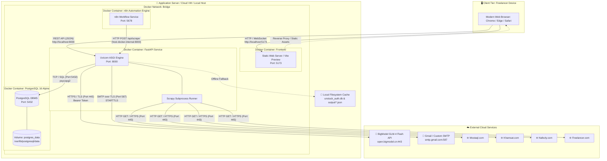
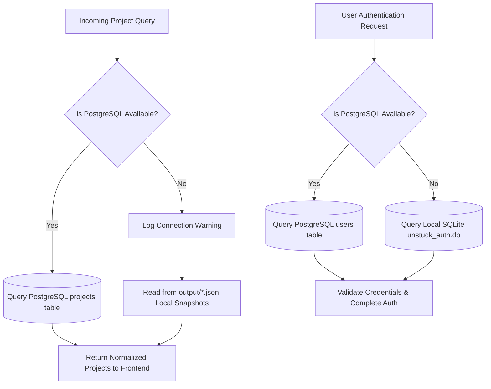

# 5.2 System Deployment Diagram
## UNSTUCK – Intelligent Freelance Intelligence Platform

---

## 1. Physical Deployment Topology

The UNSTUCK deployment architecture is engineered for multi-environment portability, supporting local development, single-click Windows execution, and fully containerized Docker deployments.

---

## 2. Network Ports & Protocols Matrix

| Node / Container | Internal Port | Host Port | Protocol | Purpose & Traffic Description |
| :--- | :--- | :--- | :--- | :--- |
| **Frontend Web Container** | `5173` | `5173` | HTTP / TCP | Serves compiled React SPA assets to client browsers. |
| **FastAPI Backend Container** | `8000` | `8000` | HTTP / TCP | Handles REST API traffic, CORS requests, and Swagger UI (`/docs`). |
| **PostgreSQL Database** | `5432` | `5432` | TCP / PostgreSQL | Serves SQL queries, index updates, and `UPSERT` transactions. |
| **n8n Automation Engine** | `5678` | `5678` | HTTP / TCP | Hosts visual automation editor and executes hourly cron schedule. |
| **SMTP Mail Server** | `587` | Outbound | TCP / STARTTLS | Secure email delivery for 6-digit OTP verification codes. |
| **GLM AI API Gateway** | `443` | Outbound | HTTPS / TLS | Secure API calls for AI-powered proposal synthesis. |
| **Freelance Marketplace Sites**| `443` | Outbound | HTTPS / TLS | Web scraping targets crawled by Scrapy spiders. |

---

## 3. High-Availability & Fallback Architecture

To guarantee uninterrupted service even during infrastructure disruptions, UNSTUCK implements a tiered failover strategy:

