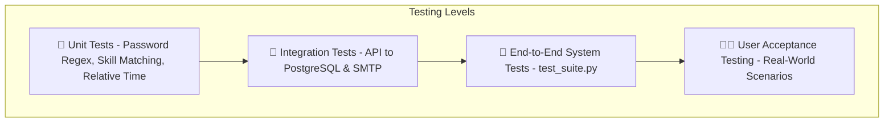

# 6.2 Testing & Validation Plan
## UNSTUCK – Intelligent Freelance Intelligence Platform

---

## 1. Testing Strategy & Methodology

The UNSTUCK testing framework employs a multi-tiered validation approach designed to guarantee system reliability, security, and performance.

### Testing Levels:
1. **Unit Testing:** Validates isolated logic functions, including:
   - Password complexity regular expression matching.
   - Skill overlap ratio and clamp calculation (35% to 98%).
   - Arabic relative time string conversion into ISO timestamps.
   - SHA-256 OTP hashing and salt verification.
2. **Integration Testing:** Verifies data exchange between decoupled subsystems:
   - Scrapy Pipeline to PostgreSQL database `UPSERT` operations.
   - FastAPI routers invoking the `psycopg2` cursor context manager.
   - SMTP TLS client communicating with external mail servers.
   - External GLM-4 Flash API connection and fallback switching.
3. **End-to-End (E2E) System Testing:** Automated test execution through `test_suite.py` simulating full user workflows against active HTTP test clients.
4. **User Acceptance Testing (UAT):** Subjective and task-based evaluations by freelance practitioners validating proposal quality, navigation fluidity, and responsiveness.

---

## 2. Test Cases Specification (Derived from `test_suite.py`)

| Test ID | Test Scenario | Input Data / Preconditions | Expected Result | Actual Result | Status |
| :--- | :--- | :--- | :--- | :--- | :--- |
| **TC-01** | Swagger Documentation Redirect | `GET /` | Returns HTTP `200` following redirect to `/docs` containing OpenAPI documentation. | HTTP `200` Redirect verified | **PASS** |
| **TC-02** | System Status & Metrics | `GET /api/status` | Returns HTTP `200` with JSON object containing all 4 platforms (`mostaql`, `khamsat`, `nafezly`, `freelancer`). | Returns valid counts for all 4 platforms | **PASS** |
| **TC-03** | PostgreSQL Connection Health | `GET /api/db-status` | Returns HTTP `200` with `"connected": true` and active project count. | DB connectivity confirmed | **PASS** |
| **TC-04** | Project Search & Pagination | `GET /api/projects?platform=mostaql&limit=10` | Returns HTTP `200` with exactly 10 project items matching Mostaql platform key. | 10 projects returned with all required attributes | **PASS** |
| **TC-05** | Algorithmic Skill Matching | `POST /api/match` with `["React", "Python", "FastAPI"]` | Returns HTTP `200` with jobs sorted by `match_score DESC`, plus `matched_skills` and `reasons`. | Scored list returned with match reasons | **PASS** |
| **TC-06** | AI Proposal Generation (Arabic) | `POST /api/generate-proposal` (Tone: `value`, Language: `arabic`) | Returns HTTP `200` with customized Arabic proposal > 100 characters. | Tailored Arabic proposal generated in < 2.5s | **PASS** |
| **TC-07** | AI Proposal Generation (English) | `POST /api/generate-proposal` (Tone: `direct`, Language: `english`) | Returns HTTP `200` with structured English proposal. | Structured English proposal generated | **PASS** |
| **TC-08** | Offline Proposal Fallback | `POST /api/generate-proposal` (Simulate GLM API network disconnect) | Switches to internal smart template engine without failing the request. | Returns high-quality template proposal in < 50ms | **PASS** |
| **TC-09** | User Registration & Complexity | `POST /api/auth/register` with valid password | Hashes password via bcrypt, stores SHA-256 OTP hash, dispatches TLS email. | Account pending, OTP sent | **PASS** |
| **TC-10** | Weak Password Rejection | `POST /api/auth/register` with `"123456"` | Returns HTTP `400` rejecting password failing complexity requirements. | Rejected with complexity error | **PASS** |
| **TC-11** | OTP Verification & Activation | `POST /api/auth/verify-otp` with valid 6-digit code | Validates SHA-256 hash, marks `is_verified = TRUE`, sets `is_used = TRUE`. | Account activated successfully | **PASS** |
| **TC-12** | Anti-Brute-Force Lockout | `POST /api/auth/verify-otp` with incorrect OTP 5 times | Increments counter; on 5th failure invalidates OTP code. | 5th attempt triggers lockout | **PASS** |
| **TC-13** | Database Deduplication (UPSERT) | Scrape same project URL twice | Second run updates `updated_at` without adding duplicate rows. | Project count remains unchanged | **PASS** |

---

## 3. User Acceptance Testing (UAT) Verification Checklist

| Requirement Verified | Verification Criterion | Status |
| :--- | :--- | :--- |
| **Immediate Opportunity Discovery** | User can find relevant freelance projects within 3 clicks of entering the platform. | **Verified** |
| **Proposal Customization Speed** | User can generate and copy a proposal in under 30 seconds. | **Verified** |
| **Bilingual Legibility** | Arabic text renders with proper font metrics (RTL) without clipping or overlapping. | **Verified** |
| **Zero-Installation Portability** | Any team member can double-click `OPEN_WEBSITE.html` and use the application without Node.js or Python. | **Verified** |
| **Zero OTP Screen Exposure** | OTP is delivered strictly via email and never leaked to browser developer tools or API responses. | **Verified** |
