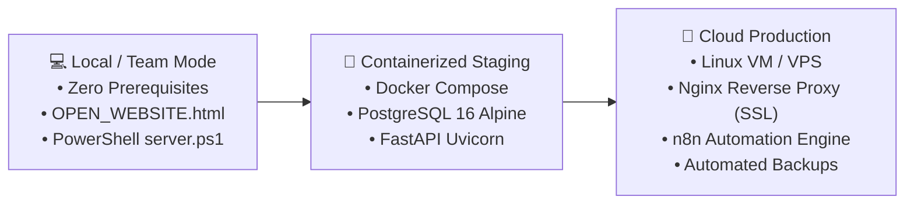
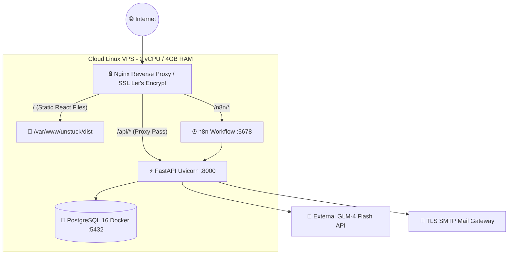
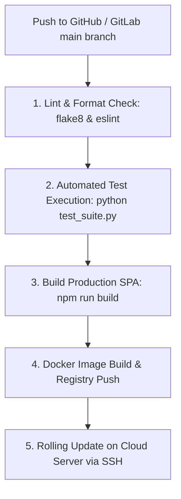

# 6.3 Deployment Strategy & DevOps Architecture
## UNSTUCK – Intelligent Freelance Intelligence Platform

---

## 1. Multi-Tier Deployment Strategy

UNSTUCK is architected with three primary deployment configurations tailored to different operational phases:



---

## 2. Deployment Configurations

### 2.1 Mode 1: Zero-Prerequisite Team Execution (Windows Local)
- **Target Audience:** Team members, evaluators, project reviewers without technical software prerequisites.
- **Execution:**
  1. Double-click `OPEN_WEBSITE.html` to instantly launch the pre-bundled React interface in any browser (Chrome, Edge, Safari, Firefox).
  2. Or double-click `تشغيل_الموقع.bat` to launch the built-in Windows PowerShell local server on port `5173`.
  3. Or double-click `START.bat` to launch the full dual-stack (FastAPI on `:8000` + React UI on `:5173`).

---

### 2.2 Mode 2: Docker Compose Containerization
- **Configuration File:** `docker-compose.yml`
```yaml
version: '3.8'

services:
  postgres:
    image: postgres:16-alpine
    container_name: scraper-postgres
    restart: unless-stopped
    environment:
      POSTGRES_USER: postgres
      POSTGRES_PASSWORD: postgres
      POSTGRES_DB: postgres
    ports:
      - "5432:5432"
    volumes:
      - postgres_data:/var/lib/postgresql/data

volumes:
  postgres_data:
```
- **Execution Commands:**
```bash
# Launch PostgreSQL database container
docker compose up -d

# Verify container status
docker ps
```

---

### 2.3 Mode 3: Production Cloud Topology



---

## 3. Continuous Integration & Continuous Deployment (CI/CD)

The recommended automated deployment pipeline consists of four automated stages:



1. **Stage 1 (Code Quality):** Verifies code formatting and catches static analysis errors.
2. **Stage 2 (Automated Test Suite):** Executes `test_suite.py` asserting all 13 critical endpoint scenarios pass with 100% success.
3. **Stage 3 (Frontend Compilation):** Executes Vite production bundling, minifying JavaScript and CSS assets into `dist/`.
4. **Stage 4 (Containerization):** Packages container images for deployment.
5. **Stage 5 (Rolling Deploy):** Pulls updated image on production server and restarts containers with zero downtime.

---

## 4. Disaster Recovery & Backup Strategy

1. **Automated Database Snapshots:**
   A scheduled daily cron job executes `pg_dump`:
   ```bash
   pg_dump -U postgres -h localhost -d postgres -F c -b -v -f /backups/unstuck_$(date +%Y%m%d).dump
   ```
2. **Dual-Layer Persistence Redundancy:**
   - Every scraped batch is simultaneously committed to PostgreSQL and serialized as a structured JSON file in `output/` (`mostaql_projects.json`, `khamsat_projects.json`, etc.).
   - In the event of catastrophic database corruption, the system can instantly restore the entire database state in one operation:
     ```bash
     py import_json_to_db.py
     ```
3. **Graceful Degradation:**
   If the PostgreSQL server experiences an unexpected restart, the FastAPI application automatically routes read requests to the JSON cache, guaranteeing zero user-visible 500 errors.
